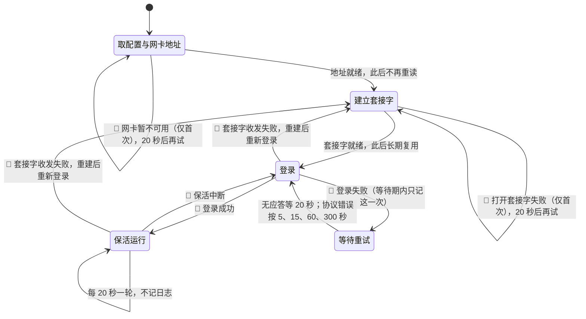

# Drcom-Go

Drcom-Go 是校园网 DRCOM 认证客户端，使用 Go 实现。

本项目在西安石油大学鄠邑校区（DRCOM 5.2-d）实测并通过。

## 适用范围

满足以下条件时可直接使用：

- 认证协议为 DRCOM 5.2-d，即纯 DHCP 方式，不含 PPPoE，也不含 802.1x，与西安石油大学鄠邑校区一致；
- 网关主机持有一块接入校园网的网卡，并已取得校园网地址；
- 认证服务器地址与四个协议常量已知，可从 [drcom-generic](https://github.com/drcoms/drcom-generic) 的校区条目或抓包确认。

以下情况不适用：

- p 版协议，其报文额外包含 `pppoe_flag` 与 `keep_alive2_flag`；
- x 版协议，采用 EAPOL，报文结构完全不同；
- 认证过程要求网页交互、短信或二次验证。

## 原理

认证绑定的是出口地址，只有持有校园网地址的网卡才能完成登录，因此客户端必须运行在网关主机上。登录成功后，内网设备通过该主机的 NAT 共享已认证的出口，无需各自认证。

## 运行行为

- 向认证服务器发送 20 字节挑战请求，从应答中取 4 字节 salt；
- 以 salt 计算摘要，发送 330 字节登录请求，从成功应答中取 16 字节会话尾；
- 每 20 秒执行一轮保活，包含一个 42 字节首保活与一对 40 字节报文；
- 保活在 10 秒内未收到 0x07 应答即判定掉线并重新登录；
- 失败只在状态切换时记一行，之后的等待期保持安静：认证服务器无回应时等 20 秒再试，应答不合协议时按 5、15、60、300 秒四档退避，登录成功后复位。
服务器在账号被其他位置顶下线时不会发送注销报文，只会停止响应，因此掉线只能由保活超时判定。

## 运行状态

状态之间的转移固化了前面两条失败处理规则，📝 表示在该转移上写一条日志。



配置、网卡地址与套接字都只在启动时准备一次。重连只重新登录，不再重读网卡、也不重开套接字；只有收发本身报错（例如没有到服务器的路由）才重建套接字。等待期间不写日志，只有状态再次切换时才会出现新的一行。


## 构建

需要 Go 1.22 或更高版本。

```
make build      # Linux amd64
make windows    # Windows amd64，配置里 Interface 填适配器名
make test
```

不使用 make 时：

```
mkdir -p dist
CGO_ENABLED=0 go build -trimpath -ldflags "-s -w" -o dist/drcom-linux-amd64 .
```

## 配置

复制 `config.example.json` 后按实际环境填写。

| 字段 | 说明 |
| --- | --- |
| Server | 认证服务器地址。西安石油大学鄠邑校区为 192.168.255.249，其他网络按实际填写 |
| Username | 校园网账号 |
| Password | 密码 |
| Interface | 持有校园网地址的网卡，例如 enp1s0f0 |
| HostName | 上报的主机名，可任意填写 |
| HostOS | 客户端标识，示例取值 8089D，来自旧客户端 |
| AuthVersion | 认证协议版本，示例 0a00 |
| KeepAliveVersion | 保活版本，示例 dc02 |
| ControlCheckStatus | 控制检查位，示例 20 |
| AdapterNum | 适配器数量位，示例 07 |
| IPDog | 地址监视位，示例 01 |

后四个字段为协议常量，取值随校区而异，示例值仅在实测环境有效，更换网络后必须重新核对。

## 协议常量怎么填

配置里 Server 起往后的字段与学校绑定，不能凭经验猜，只能取。取得方式有两种。

### 方式一：查 drcom-generic 的校区条目

[drcom-generic](https://github.com/drcoms/drcom-generic) 的 wiki 维护着各校实测参数，条目名一般是学校加校区。找到自己学校的那一条后，对照下表取值：

| 配置字段 | 条目里的名字 |
| --- | --- |
| Server | `server` 或 `dhcp_server` |
| AuthVersion | `AUTH_VERSION` |
| KeepAliveVersion | `KEEP_ALIVE_VERSION` |
| ControlCheckStatus | `CONTROLCHECKSTATUS` |
| AdapterNum | `ADAPTERNUM` |
| IPDog | `IPDOG` |

条目里的值多写成 Python 字面量，例如 `'\x0a\x00'`，对应配置里的 `"0a00"`：去掉 `\x`、小写、不加分隔。

注意 `dhcp_server` 在不同校区含义不同。西安石油大学鄠邑校区的条目里它填的是网关 10.29.6.254，而实际认证服务器是 192.168.255.249，两者不是一回事。务必先确认这个值到底是对端地址还是网关。

### 方式二：抓一次登录包

条目里没有自己学校时，只能从真实报文里取。步骤：

1. 在持有校园网地址的机器上抓 UDP 61440 的报文；
2. 触发一次登录，通常是把另一个客户端断开后重新连接；
3. 登录成功后对照 `docs/protocol.md` 的偏移表读值。

各字段在报文里的位置：

| 配置字段 | 报文位置 |
| --- | --- |
| AuthVersion | 登录请求第 310 字节起 2 字节 |
| KeepAliveVersion | 保活请求第 6 字节起 2 字节 |
| ControlCheckStatus | 登录请求第 142 字节起的固定片段 |
| AdapterNum | 登录请求第 162 字节起的固定片段 |
| IPDog | 登录请求第 105 字节起 1 字节 |
| Server | 报文的目的地址，即 UDP 对端的 IP |

取到后按配置要求的字节数写成十六进制字符串：AuthVersion 与 KeepAliveVersion 各 2 字节，其余三个各 1 字节。程序启动时会校验字节数，长度不对直接报错退出。

### 判断填对了没有

启动后看日志。填对时几秒内出现「上线成功」一行；填错时进程不会退出，而是进入等待重试，日志里只留一行失败原因，之后每 20 秒安静重试。

要看的是那一行原因：`登录无成功应答` 说明服务器有回话但拒绝了，多半是常量或账号不对；完全没有日志增长说明根本没有报文往返，多半是 Server 地址或网卡不对。

### 自查清单

- Server 必须是 UDP 61440 能到达的地址，先在目标机器上确认能通；
- Interface 必须是拿到了校园网地址的那块网卡，不是内网网卡；
- 五个十六进制字段不能留空，也不能写 PHP 或 Python 的转义写法；
- 换校区或学校升级认证系统后，这些值都要重新核对。
## 校区预设

下表是已知校区的协议常量，取自 [drcom-generic 可用学校列表](https://github.com/drcoms/drcom-generic/wiki/可用学校列表)。只收录 d 版且四项字段齐全的条目，p 版与 x 版不适用本程序。

表中 `HostOS` 只影响上报标识，可取任意值，这里统一写 `8089D`。

| 校区 | Server | AuthVersion | KeepAliveVersion | ControlCheckStatus | AdapterNum | IPDog |
| --- | --- | --- | --- | --- | --- | --- |
| 西安石油大学鄠邑校区 | 192.168.255.249 | 0a00 | dc02 | 20 | 07 | 01 |
| 广东财经大学 | 按网络实际情况填写 | 2b00 | dc02 | 20 | 03 | 01 |
| 云南师范大学商学院 杨林校区 | 172.26.0.2 | 1f00 | dc02 | 20 | 04 | 01 |
| 云南师范大学商学院 海源校区 | 192.168.0.2 | 2e00 | dc02 | 20 | 03 | 01 |
| 重庆城市管理职业学院 | 172.16.8.10 | 2b00 | dc02 | 20 | 01 | 01 |
| 武汉工程科技学院 | 10.254.253.250 | 2c00 | dc02 | 20 | 08 | 01 |

湖北长江大学与西安邮电大学是 p 版，需要额外的 `pppoe_flag` 与 `keep_alive2_flag`，本程序不支持。

示例配置对应西安石油大学鄠邑校区那一行：

```json
{
  "Server": "192.168.255.249",
  "HostOS": "8089D",
  "AuthVersion": "0a00",
  "KeepAliveVersion": "dc02",
  "ControlCheckStatus": "20",
  "AdapterNum": "07",
  "IPDog": "01"
}
```

## 部署

```
install -m 0755 dist/drcom-linux-amd64 /usr/local/bin/drcom-go
mkdir -p /etc/drcom-go && install -m 0600 config.json /etc/drcom-go/config.json
install -m 0644 deploy/drcom-go.service /etc/systemd/system/drcom-go.service
systemctl daemon-reload && systemctl enable --now drcom-go
```

配置文件含明文密码，权限设为 600。

## 日志

```
journalctl -u drcom-go -n 20
```

正常情况下保活不产生日志。登录成功输出一行；任何失败只在状态切换时输出一行，等待期内不再重复。认证服务器无回应时每 20 秒重试一次，应答不合协议时按 5、15、60、300 秒退避。

## 协议

报文结构、字段偏移与校验算法见 [docs/protocol.md](docs/protocol.md)。

## 测试

`protocol_test.go` 内置一份 330 字节登录报文的十六进制基准，由示例账号与固定 salt、MAC 生成。测试以相同输入重新构造报文并逐字节比对，用于固定字段顺序与校验算法；另有四个报文长度断言（20、42、40、40）。

校验算法有一处兼容性要求：旧实现以 `re.findall('....', s)` 取四字节组，而正则的点号不匹配 0x0a，遇到 0x0a 即断开重新分组。实现须遵循该行为，否则校验值无法与服务器一致。

## 已知限制

- 仅在西安石油大学鄠邑校区的 DRCOM 5.2-d 上验证过；p 版与 x 版不支持。
- 服务器不校验登录报文中的地址与 MAC。抓包中填写的是过期地址与另一网卡的 MAC，登录仍然成功。该结论来自实测，协议文档中并无说明。
- 程序按网卡名查地址，Windows 下 Interface 需填适配器名（如「以太网」），不能沿用 Linux 的 enp1s0f0 之类。认证流程在 Windows 上尚未实测。
- 配置文件位置：Linux 上默认 `/etc/drcom-go/config.json`；Windows 上取程序所在目录的 `config.json`，可用 `-config` 指定其他路径。文件不存在时程序会生成一份模板并退出。
- 不保存状态文件，也不提供查询子命令，运行状态以日志为准。

## 许可

MIT，见 [LICENSE](LICENSE)。
